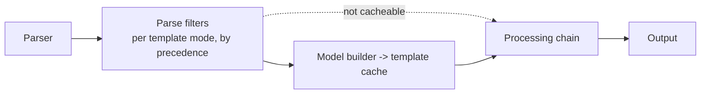

# Parse filters and parse-time whitespace collapsing

Kedos addition to Thymeleaf 3.1.6. Off unless a dialect enables it, so upstream behaviour is unchanged by default.

## What it is

A **parse filter** transforms template events *while the template is parsed*: after the parser, before the
template cache and before any processing. Its output is computed once per parsed template and then replayed from
the cache on every render. Post-processors (`IPostProcessor`) do their work on every render instead.



- Every parse route goes through the filters: cacheable and non-cacheable templates, fragment selection
  (`th:insert`/`th:replace` with `::`), `TemplateManager.parseString`, and throttled (reactive) processing.
  Dev (cache off) and prod (cache on) therefore produce the same output.
- Filters see **template markup only**. Text produced while processing (`th:text`, `th:utext`, inlined
  expressions, content from other dialects) never passes through them.

### API

| Type | Role |
|---|---|
| `org.thymeleaf.parsefilter.IParseFilter` | `getTemplateMode()`, `getPrecedence()` (lower runs first, closer to the parser), `createHandler(next)` (one new handler per parse, so it may keep state) |
| `org.thymeleaf.dialect.IParseFilterDialect` | A dialect contributing parse filters |
| `org.thymeleaf.parsefilter.ParseFilters` | Internal: resolves filters per template mode once, when `TemplateManager` is created |

## Whitespace collapsing

Enable it by registering `org.thymeleaf.parsefilter.WhitespaceCollapsingDialect`. With Spring Boot's Thymeleaf
auto-configuration, every `IDialect` bean is added to the engine:

```java
@Bean
public WhitespaceCollapsingDialect whitespaceCollapsingDialect() {
    return new WhitespaceCollapsingDialect();
}
```

The rules (HTML template mode only):

1. A text event made only of HTML whitespace (space, tab, LF, CR, FF) becomes a single `\n`. Text containing
   anything else, including non-breaking spaces, is left as is.
2. Consecutive whitespace-only text events produce one `\n`.
3. Text inside `pre`, `textarea`, `script` and `style`, at any depth, is left as is. Unmatched closing tags do not
   end preservation.
4. Comments, CDATA, DOCTYPE and all tags pass through unchanged.

### Known differences from a per-render post-processor

| Case | Parse-time collapsing |
|---|---|
| Whitespace in processing output (`th:utext` HTML, `th:text` values) | Not collapsed |
| Whitespace either side of an element removed during processing (`th:block`, `th:remove`, false `th:if`) | Each side is collapsed separately, so `\n\n` can appear where a post-processor would give `\n` |
| A fragment selected from *inside* a `pre`/`textarea`/`script`/`style` element | Cannot see that ancestor, so its whitespace-only text is collapsed |
| CSS `white-space: pre` on other elements | Collapsed (not detectable from markup) |

Browsers render all of these identically except the last one. Compare output with whitespace normalised, not
byte for byte.

## Tests

`tests/thymeleaf-tests-core/src/test/java/org/thymeleaf/parsefilter/WhitespaceCollapsingParseFilterTest.java`
(19 cases). Each rule is checked on both the cacheable and the non-cacheable path. The tests also cover fragment
insertion, `th:each`, the TEXT mode exclusion, and output without the dialect. The full core suite passes unchanged.

## Next

- TODO: static-run coalescing (investigation item 3.1) as a second parse filter running after whitespace
  collapsing, merging balanced static subtrees into single text events.
