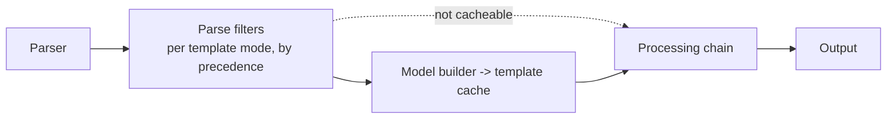
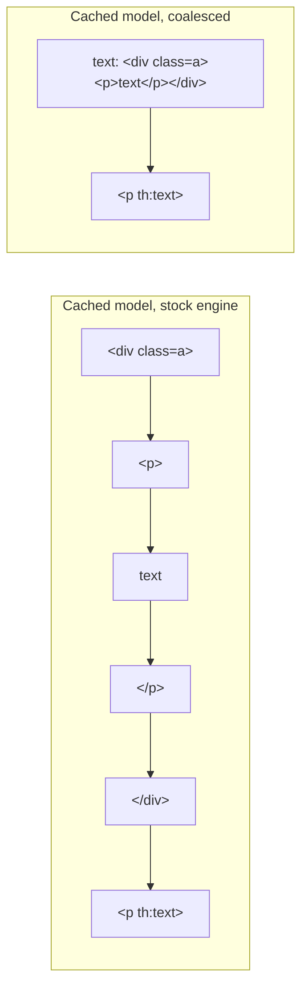

# Parse filters and parse-time whitespace collapsing

Kedos addition to Thymeleaf 3.1.6. Off unless a dialect enables it, so upstream behaviour is unchanged by default.

## What it is

A **parse filter** transforms template events *while the template is parsed*: after the parser, before the
template cache and before any processing. Its output is computed once per parsed template and then replayed from
the cache on every render. Post-processors (`IPostProcessor`) do their work on every render instead.



- Every parse route goes through the filters: cacheable and non-cacheable templates, fragment selection
  (`th:insert`/`th:replace` with `::`), `TemplateManager.parseString`, and throttled (reactive) processing.
  Dev (cache off) and prod (cache on) therefore produce the same output.
- Filters see **template markup only**. Text produced while processing (`th:text`, `th:utext`, inlined
  expressions, content from other dialects) never passes through them.

### API

| Type | Role |
|---|---|
| `org.thymeleaf.parsefilter.IParseFilter` | `getTemplateMode()`, `getPrecedence()` (lower runs first, closer to the parser), `createHandler(next)` (one new handler per parse, so it may keep state) |
| `org.thymeleaf.dialect.IParseFilterDialect` | A dialect contributing parse filters |
| `org.thymeleaf.parsefilter.ParseFilters` | Internal: resolves filters per template mode once, when `TemplateManager` is created |

## Whitespace collapsing

Enable it by registering `org.thymeleaf.parsefilter.WhitespaceCollapsingDialect`. With Spring Boot's Thymeleaf
auto-configuration, every `IDialect` bean is added to the engine:

```java
@Bean
public WhitespaceCollapsingDialect whitespaceCollapsingDialect() {
    return new WhitespaceCollapsingDialect();
}
```

The rules (HTML template mode only):

1. A text event made only of HTML whitespace (space, tab, LF, CR, FF) becomes a single `\n`. Text containing
   anything else, including non-breaking spaces, is left as is.
2. Consecutive whitespace-only text events produce one `\n`.
3. Text inside `pre`, `textarea`, `script` and `style`, at any depth, is left as is. Unmatched closing tags do not
   end preservation.
4. Comments, CDATA, DOCTYPE and all tags pass through unchanged.

### Known differences from a per-render post-processor

| Case | Parse-time collapsing |
|---|---|
| Whitespace in processing output (`th:utext` HTML, `th:text` values) | Not collapsed |
| Whitespace either side of an element removed during processing (`th:block`, `th:remove`, false `th:if`) | Each side is collapsed separately, so `\n\n` can appear where a post-processor would give `\n` |
| A fragment selected from *inside* a `pre`/`textarea`/`script`/`style` element | Cannot see that ancestor, so its whitespace-only text is collapsed |
| CSS `white-space: pre` on other elements | Collapsed (not detectable from markup) |

Browsers render all of these identically except the last one. Compare output with whitespace normalised, not
byte for byte.

## Static-run coalescing

Enable it by registering `org.thymeleaf.parsefilter.StaticRunCoalescingDialect`, alongside the whitespace dialect
or on its own:

```java
@Bean
public StaticRunCoalescingDialect staticRunCoalescingDialect() {
    return new StaticRunCoalescingDialect();
}
```

**What it does:**
- At parse time it merges each maximal run of *static* events into one pre-rendered text event, flagged as static
  markup.
- `ProcessorTemplateHandler` passes flagged text straight to output, without running text processors or inlining.
- Rendered output is **byte-identical** to the stock engine. Each render just dispatches, tracks and writes far
  fewer events.



### What counts as static

| Event | Static when |
|---|---|
| Element (open + close, or standalone) | No processor is associated with the tag, and every descendant is static |
| Text | Not inlineable (no `[[...]]` / `[(...)]`), and the only text processors configured are the standard inlining one |
| Comment | Not inlineable, contains no `[` (rules out conditional comments), and only standard comment processors are configured |
| CDATA | Not inlineable, and only the standard inlining CDATA processor is configured |
| DOCTYPE, XML declaration, processing instruction, unmatched close tag | Never |

### Element events that are always kept

| Case | Why |
|---|---|
| Root-level elements of a template or fragment | Fragment inclusion (`th:include`) works on the root elements of the inserted model |
| Direct children of an element with processors | Processors can act on child elements, e.g. `th:remove="all-but-first"` keeps the first child *element* |
| Everything inside an element with a model processor | Model processors receive and may inspect the element's whole model |
| A whitespace-only text right before an element | `th:each` repeats the whitespace text preceding the iterated element between iterations |

**When it switches itself off:** if any pre-processor or post-processor is configured for HTML, coalescing is
disabled and a warning is logged once. Those processors observe the event stream, which coalescing would change.

### Verification

- **Upstream suites with coalescing forced on.** Both suites were run with coalescing enabled on every test engine,
  through a new opt-in hook in the testing library (`-Dthymeleaf.testing.additionalDialects=<dialect classes>`):
  - core: 1,277 tests, all pass;
  - Spring 6: 532 tests, all pass. The hook reaches 337 of these; the rest don't use the test executor.

  A bogus dialect name makes every hooked test fail, which confirms the hook is applied.
- **Dedicated tests** (`StaticRunCoalescingParseFilterTest`) check that output is identical with and without
  coalescing, and that the cached model shrinks. Each case is checked uncached, on first render and on render from
  the cache. They cover:
  - iteration whitespace;
  - all `th:remove` modes;
  - conditionals, `th:with`, `th:switch`, `th:object`;
  - text, JavaScript and CSS inlining;
  - comments, conditional comments, parser-level comments, CDATA;
  - DOCTYPE and unmatched tags;
  - `th:insert`/`th:replace`/`th:include` by name, id and parameterised fragment;
  - a custom model processor;
  - the post-processor switch-off;
  - combination with whitespace collapsing.

## Tests

| Test class | Cases |
|---|---|
| `tests/thymeleaf-tests-core/.../parsefilter/WhitespaceCollapsingParseFilterTest` | 19 |
| `tests/thymeleaf-tests-core/.../parsefilter/StaticRunCoalescingParseFilterTest` | 14 |

The full core suite passes with and without coalescing enabled.

## Benchmarks

See `benchmarks/thymeleaf-benchmarks/README.md`.
