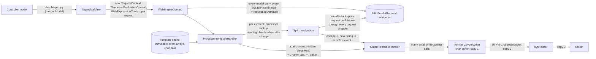
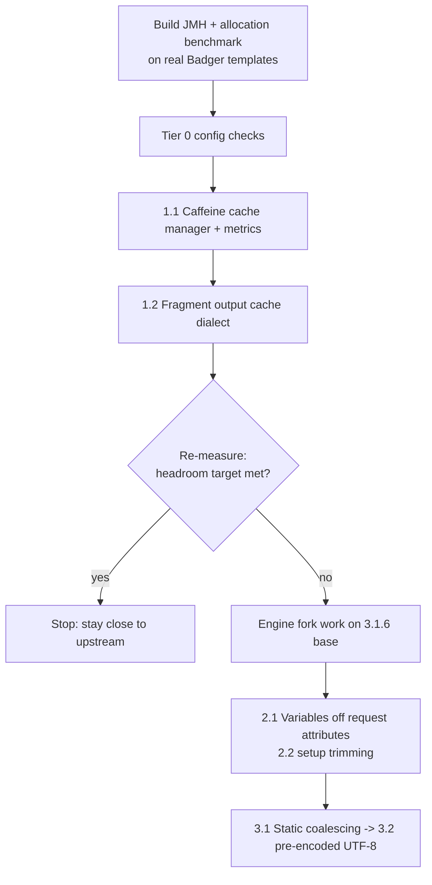

# Thymeleaf rendering performance: investigation for Badger Commerce

Date: 2026-11-08 · Scope: Thymeleaf core + `thymeleaf-spring6`, upstream tag `thymeleaf-3.1.6.RELEASE`

## 1. Summary

| Question | Answer |
|---|---|
| Latest upstream release | **3.1.6.RELEASE** (Maven Central and GitHub). There is no 3.1.7 or 3.1.8. |
| Where the code now lives | Upstream merged `thymeleaf-spring` into the **`thymeleaf/thymeleaf` monorepo** (`lib/thymeleaf`, `lib/thymeleaf-spring6`, …). The `thymeleaf/thymeleaf-spring` repo our fork tracks is no longer the source of truth. Our fork is at spring6 `3.1.1.RELEASE`. |
| Is there low-hanging fruit? | **Yes.** Some needs config only, some only a plugin in Badger, and a few contained patches need a fork. Section 4 ranks them. |
| Rewrite the core in Rust? | **No.** Expression evaluation runs against live JVM objects, so every expression would cross the JNI/FFM boundary. The model would also have to be marshalled across, which adds copying instead of removing it. If we ever replace the engine, the realistic target is a precompiled JVM engine (e.g. JTE). See section 6. |
| Biggest single lever | **Cache the rendered output of shared page chrome** (header, mega-menu, footer, static CMS blocks) in Badger. This lives in the app, not the engine. Next comes structural work in the engine: storing variables outside request attributes, and merging and pre-encoding static markup. |

All gains below are estimates until measured. Section 7 sets out the benchmark harness to build first.

## 2. How a page renders today, and where the copies are

What the code shows (3.1.6):

- **Static markup is re-encoded on every request.** The template cache keeps markup as `char[]` events. Every render writes those events to Tomcat in many small writes, then Tomcat encodes them to UTF-8 again. On a typical storefront page most of the bytes are static.
- **Unprocessed elements are cheap, but not free.** `ProcessorTemplateHandler.handleOpenElement` has a fail-fast path for elements without processors. Each such element still goes through the model controller, element-stack tracking in the engine context, and several writer calls.
- **Variables live in request attributes.** `WebEngineContext` stores all variables through `webExchange.setAttributeValue(...)`, including locals from `th:each` and `th:with` (`WebEngineContext.java` ~L690–725). Old values are also read and restored when each level ends. So every loop iteration costs several `setAttribute`/`getAttribute` calls, each passing through every servlet request wrapper (Spring Security, session, etc.). Every `${x.y}` also resolves `x` through `request.getAttribute`. The non-web `EngineContext` already keeps variables in a local structure.
- **The caches are small and evict FIFO.** In `StandardCacheManager`, the template cache defaults to 200 entries and the expression cache to 500. `StandardCache` evicts first-in-first-out, not LRU or LFU. A large template estate evicts hot entries, which then get re-parsed (SpEL parse plus Thymeleaf expression parse). The cache key includes fragment selectors, so each `file :: fragment` pair uses its own slot.
- **The SpEL compiler is off by default.** It is `SpringTemplateEngine.setEnableSpringELCompiler`, or `spring.thymeleaf.enable-spring-el-compiler` in Boot. When on, it runs in `MIXED` mode.
- **Each request allocates its own setup objects.** `ThymeleafView.renderFragment` creates the following per request: a `HashMap(30)` copy of the model, Spring's `RequestContext` (which resolves locale and theme), a `SpringWebMvcThymeleafRequestContext`, a `ThymeleafEvaluationContext` (with a new `BeanFactoryResolver` and `StandardTypeConverter`), a `WebExpressionContext`, and a new processing handler chain. This is a few microseconds per request: worth trimming, but not the main cost.
- **Things that are already fine:**
  - `th:replace` and `th:insert` reuse the cached fragment model without cloning it. Only the deprecated `th:include` clones.
  - Text inlining checks (`[[…]]`) are cached on each `Text` event.
  - `producePartialOutputWhileProcessing` defaults to `true`. If it is `false`, a whole-page `FastStringWriter` buffer and `toString()` are added, which costs two more full copies.

## 3. Repo and version position

- This branch has been **reset onto `thymeleaf/thymeleaf` at `thymeleaf-3.1.6.RELEASE`** (the monorepo: `lib/thymeleaf`, `lib/thymeleaf-spring6`, …), keeping full upstream history. This means future upstream releases can be merged in directly.
- Kedos changes live on top of that tag. Kedos documentation lives in `docs/kedos/`.
- TODO: choose a Kedos version suffix (e.g. `3.1.6.KEDOS-1`) and a private registry for publishing before any engine patch ships.

## 4. Opportunities, ranked

Legend: **Gain** = expected effect on CPU/allocation for a typical PLP/PDP render (to be confirmed by section 7). **Where** = config / Badger code / engine fork.

### Tier 0: config only, no fork (do these first)

| # | Change | Where | Gain | Effort | Risk |
|---|---|---|---|---|---|
| 0.1 | Confirm production runs with `spring.thymeleaf.cache=true` and resolver `cacheable=true` with no TTL. | config | High if wrong today | XS | None |
| 0.2 | Enable the SpEL compiler: `spring.thymeleaf.enable-spring-el-compiler=true`. | config | Low–Med on expression-heavy pages | XS | Low. MIXED mode falls back to interpreting on a type mismatch. Must be measured: compilation only applies when every accessor in an expression is compilable. |
| 0.3 | Keep `produce-partial-output-while-processing=true` (the default); check nobody turned it off. | config | Med if off | XS | None |
| 0.4 | Check that the Badger `MessageSource` (site text) behind `#{…}` is in-memory and caches `MessageFormat`s, not a lookup per call. | Badger | Potentially high | S | None |

### Tier 1: pluggable from Badger, no fork

| # | Change | Where | Gain | Effort | Risk |
|---|---|---|---|---|---|
| 1.1 | **Swap the cache implementation.** Implement `ICacheManager` backed by Caffeine (W-TinyLFU, much better hit rate than FIFO). Size it from real counts (thousands of expressions, not 500). Export hit/miss to Micrometer. Register with `SpringTemplateEngine.setCacheManager(...)`. | Badger | Med–High where caches thrash today | S | Low |
| 1.2 | **Fragment output caching dialect.** Add an attribute processor, e.g. `bc:cache="'megamenu:' + ${site.id}"`. It caches the *rendered string* of an element per key, locale and content version, and replays it as one unescaped text event. Use it for header, mega-menu, footer and static CMS extensions. Evict on content publish. | Badger | **Highest.** Removes the whole subtree from processing. | M | Medium. The key must include every input; user-specific parts (basket count, login state) must be kept out. |
| 1.3 | **Template hygiene in hot paths:** avoid `__${…}__` preprocessing, since each distinct value creates a new cache entry and pollutes the expression cache; replace `th:include` with `th:insert`/`th:replace`; move computation out of `th:each` bodies into view-model getters; avoid `T(...)` and method-heavy SpEL inside loops. | Badger | Med | S–M | Low |
| 1.4 | JVM: Java 21+ with virtual threads (`spring.threads.virtual.enabled=true`) to cut per-request thread stacks at high concurrency, and size the young generation for this allocation-heavy workload. | config | Memory/concurrency | S | Low–Med |

### Tier 2: engine fork patches, contained

| # | Change | Where (core) | Gain | Effort | Risk |
|---|---|---|---|---|---|
| 2.1 | **Store variables off request attributes.** Give `WebEngineContext` an option to keep model and local variables in its own level-indexed structure, the same as `EngineContext`, falling back to request attributes on read. This removes the `set`/`get`/restore round trips through the request-wrapper chain for every loop variable and lookup. | `context/WebEngineContext` | Med–High on loop-heavy pages (PLP grids, menus) | M | Medium. Any code that reads template variables as request attributes mid-render (custom dialects, JSP-era includes) breaks, so put it behind a config flag. |
| 2.2 | Request-setup trimming: reuse one `StandardTypeConverter` per `ConversionService` and one `BeanFactoryResolver` per context, and skip the second `RequestContext` alias (`springMacroRequestContext`) when unused. | `spring6/view/ThymeleafView`, `ThymeleafEvaluationContext` | Low | S | Low |
| 2.3 | Always-on cheap cache counters (`LongAdder`) instead of counters only under TRACE logging, so hit rates are visible in production. Moot if 1.1 is done. | `cache/StandardCache` | Observability | XS | None |

### Tier 3: engine fork, structural (the "minimise copies" work)

| # | Change | Gain | Effort | Risk |
|---|---|---|---|---|
| 3.1 | **Static-run coalescing.** When a template enters the cache, merge every *balanced* subtree and text run with no processors, no inlining markers and no selector-relevant boundaries into a single pre-rendered `Text` event. Event count, handler dispatch and writer calls drop by roughly the share of static markup. | High (CPU) | M–L | Medium. Must keep model levels balanced for `th:each` gathering, must not merge across fragment selector boundaries, and must be disabled for dialects with wildcard element processors. Needs the upstream test suite (`tests/`) green. |
| 3.2 | **Pre-encoded UTF-8 output.** Store a `byte[]` beside each coalesced static `Text`, and add an output path that writes those bytes straight to `ServletOutputStream`. Only the dynamic fragments (escaped values) get encoded. This removes copy 1 and copy 2 in the diagram for most of the page; it is the same technique JTE uses. | High (CPU + allocation) | L | Medium–High. Thymeleaf's public API is `Writer`-based, so this needs a byte-aware `Writer`/`OutputStream` bridge, and the content type must be UTF-8. |
| 3.3 | Escaping straight to the writer: `th:text` currently escapes into a new `String`, wraps it in a new `Text` event and then writes it. Escaping directly into the output would remove two allocations per dynamic value. | Med (allocation) | M | Low–Med |

3.1 and 3.2 together are what "minimise the copy work" means in this engine. They are a real fork divergence from upstream, so we should only take them on after Tiers 0–2 are measured.

## 5. Recommended sequence

## 6. Replacing the engine (Rust or otherwise)

**Rust or another native engine behind the Spring wrapper: not recommended.**

- **Expressions are the expensive part, and they are JVM-bound.** `${product.price}`, `#{…}`, `th:field` binding, `ConversionService` formatting and the Spring Security extras all call into live Java objects. A native renderer would cross JNI/FFM for each one, i.e. hundreds to thousands of calls per page. The boundary overhead plus object marshalling cancels the gains.
- **Alternatively, serialise the model to the native side up front.** That adds a full copy of the model per request, the opposite of the goal, and loses lazy access (lazy JPA associations, computed getters).
- **All dialects and processors would be rewritten**: Standard, Spring, Security, and Badger's own. Template compatibility would become a long tail.
- **Operationally**, a native library adds per-platform builds and crash domains inside the JVM.

**If we ever replace the engine**, the credible option is a **precompiled JVM template engine**, e.g. JTE, or Rocker.

- Templates compile to Java classes with static content pre-encoded as UTF-8 `byte[]`, so allocation is close to zero and there are no runtime expression parsers.
- Public benchmarks consistently put these well ahead of Thymeleaf.
- The cost is a template rewrite: different syntax, and no natural-HTML templates that designers can open in a browser.
- A gradual path is possible: run both view resolvers side by side and migrate the hottest pages (PLP, PDP, home) first.

Tier 3 (3.1 + 3.2) gets a large share of that benefit while keeping existing templates. That is why it comes before any replacement.

## 7. Measurement plan (do first)

1. **Benchmark module.** Add a JMH module in the fork that renders captured, anonymised Badger models through real templates (home, PLP with 48 tiles, PDP, basket). Use `MockHttpServletRequest` through `ThymeleafView` so the Spring layer is included.
   - Report `ops/s` and **`gc.alloc.rate.norm` (bytes/render)** via `-prof gc`.
2. **Staging profile.** Run async-profiler (`-e cpu` and `-e alloc`) under a load test in staging to confirm where the time goes in the real app: SpEL vs request attributes vs output vs the `MessageSource`.
3. **Cache hit rates.** Run with TRACE on `org.thymeleaf.TemplateEngine.cache` once in a test environment, or with 1.1 in place, to get real cache sizes.
4. **Exit criteria per change.** Merge a change when it improves bytes/render or ops/s by at least 5% on at least two page types, with no output diff across a golden-file render of the template estate.

## 8. Priorities for p99 latency and pages per instance

Agreed target: **p99 latency first, then pages per instance.** This reorders the work as follows.

**p99 drivers to rule out first (most are outside the engine):**

1. **Database calls during render.** Check whether `spring.jpa.open-in-view` is on and whether templates touch lazy associations inside `th:each`. N+1 queries during rendering are the most common cause of a long p99 tail on Thymeleaf storefronts, and they show up as render time.
2. **Cache misses.** With FIFO eviction, a miss means reading the template resource and parsing it, which takes milliseconds, not microseconds. That puts **1.1 (Caffeine cache manager + hit-rate metrics) at the top.**
3. **Cold start after deploy.** Add a warm-up step that renders the key pages (home, top PLPs, a PDP) before the readiness probe passes. This fills the template and expression caches and lets the JIT and SpEL compiler warm up before real traffic arrives.
4. **GC pauses.** Rendering allocates heavily. On Java 21+, try Generational ZGC (`-XX:+UseZGC -XX:+ZGenerational`) and compare p99 against G1 under the same load.

**Then, for both p99 and pages per instance:**

5. **1.2 Fragment output caching.** It removes whole subtrees (header, mega-menu, footer) from every render: lower mean, lower variance.
6. **2.1 Variables off request attributes**, then **3.1 + 3.2 (static coalescing, pre-encoded UTF-8)**. These cut CPU and allocation per page, which directly raises pages per instance and lowers GC pressure.

The benchmark harness (section 7) should therefore record **p99 render time and bytes allocated per render** as well as throughput. The staging load test should report end-to-end p99 split into render time vs data fetch.

## 9. Status of open decisions

| Decision | Outcome |
|---|---|
| Re-base fork onto upstream 3.1.6 | Done on this branch. |
| Location of storefront templates | `badger-commerce`, on the director's machine and in GitLab. Not yet reachable from this cloud session; needed for cache sizing, the `__${}__`/`th:include` scan and choosing fragments to cache. |
| Optimisation target | p99 latency, then pages per instance (section 8). |
